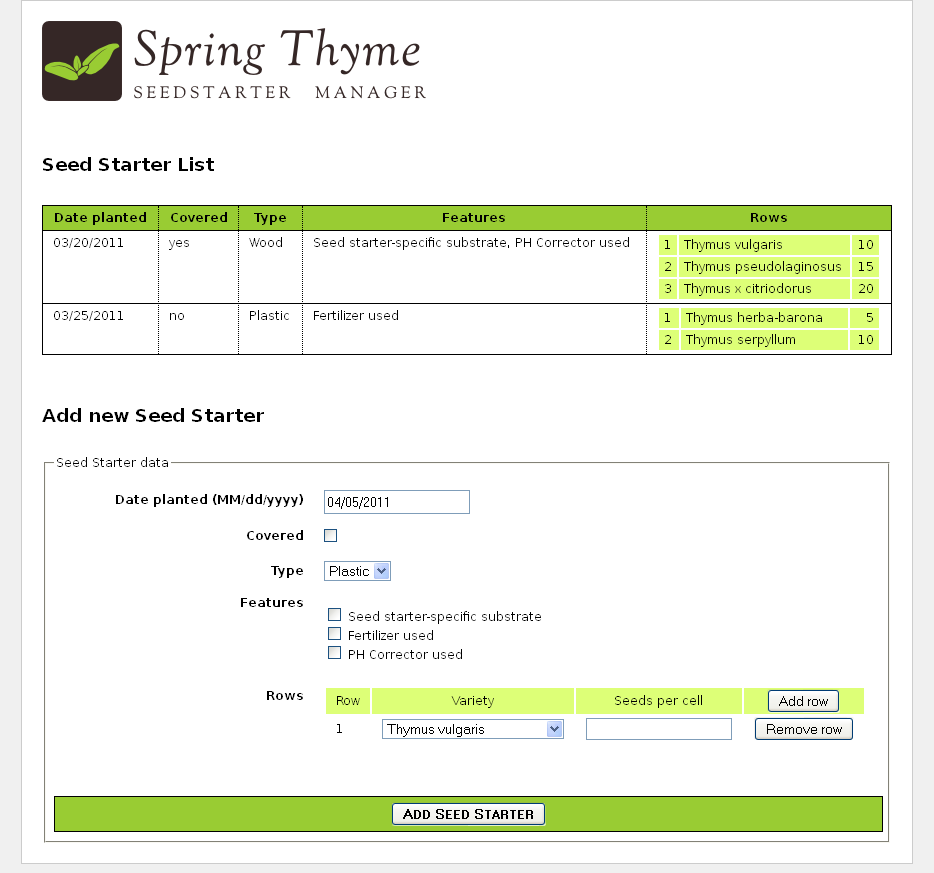
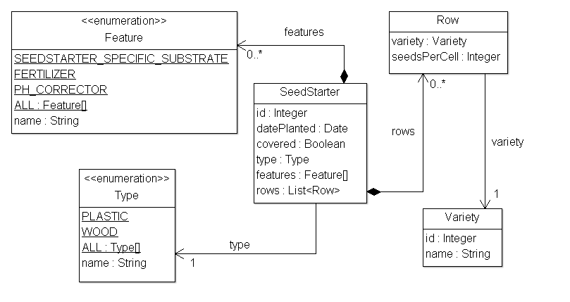

The source code for the examples shown in this and future chapters of this guide
can be found in the _Spring Thyme Seed Starter Manager (STSM)_ example app:

   * [Spring 5 STSM](https://github.com/thymeleaf/thymeleaf/tree/3.1-master/examples/spring5/thymeleaf-examples-spring5-stsm).
   * [Spring 6 STSM](https://github.com/thymeleaf/thymeleaf/tree/3.1-master/examples/spring6/thymeleaf-examples-spring6-stsm).

## The Concept

At Thymeleaf we're huge fans of thyme, and every spring we prepare our seed
starting kits with good soil and our favourite seeds, place them under the
Spanish sun and patiently wait for our new plants to grow.

But this year we got fed up with sticking labels to the seed starter containers
for knowing which seed was in each cell of the container, so we decided to
prepare an application using Spring MVC and Thymeleaf to help us catalogue our
starters: _The Spring Thyme SeedStarter Manager_.



In a similar way to the Good Thymes Virtual Grocery application we developed in
the _Using Thymeleaf_ tutorial, the STSM will allow us to exemplify the most
important aspects of the integration of Thymeleaf as a template engine for
Spring MVC.

## Business Layer

We will need a very simple business layer for our application. First of all,
let's have a look at our model entities:



A couple of very simple service classes will provide the required business
methods. Like:

```java
@Service
public class SeedStarterService {

    @Autowired
    private SeedStarterRepository seedstarterRepository; 

    public List<SeedStarter> findAll() {
        return this.seedstarterRepository.findAll();
    }

    public void add(final SeedStarter seedStarter) {
        this.seedstarterRepository.add(seedStarter);
    }

}
```

And:

```java
@Service
public class VarietyService {

    @Autowired
    private VarietyRepository varietyRepository; 

    public List<Variety> findAll() {
        return this.varietyRepository.findAll();
    }

    public Variety findById(final Integer id) {
        return this.varietyRepository.findById(id);
    }

}
```

## The Controller

Of course, we will also need a controller for our application. As the STSM will
only contain one web page with a list of seed starters and a form for adding new
ones, we will write only one controller class for all the server interactions:

```java
@Controller
public class SeedStarterMngController {

    @Autowired
    private VarietyService varietyService;
    
    @Autowired
    private SeedStarterService seedStarterService;

    ...

}
```

Now let's see what we can add to this controller class.

### Model Attributes

First we will add some model attributes that we will need in the page:

```java
@ModelAttribute("allTypes")
public List<Type> populateTypes() {
    return Arrays.asList(Type.ALL);
}
    
@ModelAttribute("allFeatures")
public List<Feature> populateFeatures() {
    return Arrays.asList(Feature.ALL);
}
    
@ModelAttribute("allVarieties")
public List<Variety> populateVarieties() {
    return this.varietyService.findAll();
}
    
@ModelAttribute("allSeedStarters")
public List<SeedStarter> populateSeedStarters() {
    return this.seedStarterService.findAll();
}
```

### Mapped methods

And now the most important part of a controller, the mapped methods: one for
showing the form page, and another one for processing the addition of new `SeedStarter`
objects.

```java
@RequestMapping({"/","/seedstartermng"})
public String showSeedstarters(final SeedStarter seedStarter) {
    seedStarter.setDatePlanted(Calendar.getInstance().getTime());
    return "seedstartermng";
}

@RequestMapping(value="/seedstartermng", params={"save"})
public String saveSeedstarter(
        final SeedStarter seedStarter, final BindingResult bindingResult, final ModelMap model) {
    if (bindingResult.hasErrors()) {
        return "seedstartermng";
    }
    this.seedStarterService.add(seedStarter);
    model.clear();
    return "redirect:/seedstartermng";
}
```

## Listing Seed Starter Data

The first thing that our `/WEB-INF/templates/seedstartermng.html` page will show
is a listing with the seed starters currently stored. For this we will need some
externalized messages and also some expression evaluation on model attributes.
Like this:

```html
<div class="seedstarterlist" th:unless="${#lists.isEmpty(allSeedStarters)}">
    
  <h2 th:text="#{title.list}">List of Seed Starters</h2>
  
  <table>
    <thead>
      <tr>
        <th th:text="#{seedstarter.datePlanted}">Date Planted</th>
        <th th:text="#{seedstarter.covered}">Covered</th>
        <th th:text="#{seedstarter.type}">Type</th>
        <th th:text="#{seedstarter.features}">Features</th>
        <th th:text="#{seedstarter.rows}">Rows</th>
      </tr>
    </thead>
    <tbody>
      <tr th:each="sb : ${allSeedStarters}">
        <td th:text="${{sb.datePlanted}}">13/01/2011</td>
        <td th:text="#{|bool.${sb.covered}|}">yes</td>
        <td th:text="#{|seedstarter.type.${sb.type}|}">Wireframe</td>
        <td th:text="${#strings.arrayJoin(
                           #messages.arrayMsg(
                               #strings.arrayPrepend(sb.features,'seedstarter.feature.')),
                           ', ')}">Electric Heating, Turf</td>
        <td>
          <table>
            <tbody>
              <tr th:each="row,rowStat : ${sb.rows}">
                <td th:text="${rowStat.count}">1</td>
                <td th:text="${row.variety.name}">Thymus Thymi</td>
                <td th:text="${row.seedsPerCell}">12</td>
              </tr>
            </tbody>
          </table>
        </td>
      </tr>
    </tbody>
  </table>
</div>
```

Lots to see here. Let's have a look at each fragment separately.

First of all, this section will only be shown if there are any seed starters. We
achieve that with a th:unless attribute and the `#lists.isEmpty(...)` function.

```html
<div class="seedstarterlist" th:unless="${#lists.isEmpty(allSeedStarters)}">
```

Note that all utility objects like `#lists` are available in Spring EL
expressions just as they were in OGNL expressions in the Standard Dialect.

The next thing to see is a lot of internationalized (externalized) texts, like:

```html
<h2 th:text="#{title.list}">List of Seed Starters</h2>

<table>
  <thead>
    <tr>
      <th th:text="#{seedstarter.datePlanted}">Date Planted</th>
      <th th:text="#{seedstarter.covered}">Covered</th>
      <th th:text="#{seedstarter.type}">Type</th>
      <th th:text="#{seedstarter.features}">Features</th>
      <th th:text="#{seedstarter.rows}">Rows</th>
      ...
```

This being a Spring MVC application, we already defined a `MessageSource` bean
in our Spring configuration (`MessageSource` objects are the standard way of
managing externalized texts in Spring MVC):

```java
@Bean
public ResourceBundleMessageSource messageSource() {
    ResourceBundleMessageSource messageSource = new ResourceBundleMessageSource();
    messageSource.setBasename("Messages");
    return messageSource;
}
```

...and that `basename` property indicates that we will have files like `Messages_es.properties`
or `Messages_en.properties` in our classpath. Let's have a look at the Spanish
version:

```properties
title.list=Lista de semilleros

date.format=dd/MM/yyyy
bool.true=sí
bool.false=no

seedstarter.datePlanted=Fecha de plantación
seedstarter.covered=Cubierto
seedstarter.type=Tipo
seedstarter.features=Características
seedstarter.rows=Filas

seedstarter.type.WOOD=Madera
seedstarter.type.PLASTIC=Plástico

seedstarter.feature.SEEDSTARTER_SPECIFIC_SUBSTRATE=Sustrato específico para semilleros
seedstarter.feature.FERTILIZER=Fertilizante
seedstarter.feature.PH_CORRECTOR=Corrector de PH
```

In the first column of the table listing we will show the date when the seed
starter was prepared. But **we will show it formatted** in the way we defined 
in our `DateFormatter`. In order to do that we will use the double-brace 
syntax (`${{...}}`), which will automatically apply the Spring Conversion Service,
including the `DateFormatter` we registered at configuration.

```html
<td th:text="${{sb.datePlanted}}">13/01/2011</td>
```

Next is showing whether the seed starter container is covered or not, by
transforming the value of the boolean covered bean property into an
internationalized _"yes"_ or _"no"_ with a literal substitution expression:

```html
<td th:text="#{|bool.${sb.covered}|}">yes</td>
```

Now we have to show the type of seed starter container. Type is a java enum with
two values (`WOOD` and `PLASTIC`), and that's why we defined two properties in
our `Messages` file called `seedstarter.type.WOOD` and `seedstarter.type.PLASTIC`.

But in order to obtain the internationalized names of the types, we will need to
add the `seedstarter.type.` prefix to the enum value by means of an expression,
which result we will then use as the message key:

```html
<td th:text="#{|seedstarter.type.${sb.type}|}">Wireframe</td>
```

The most difficult part of this listing is the _features_ column. In it we want
to display all the features of our container ---that come in the form of an array
of `Feature` enums---, separated by commas. Like _"Electric Heating, Turf"_.

Note that this is particularly difficult because these enum values also need to
be externalized, as we did with Types. The flow is then:

1. Prepend the corresponding prefix to all the elements of the `features` array.
2. Obtain the externalized messages corresponding to all the keys from step 1.
3. Join all the messages obtained in step 2, using a comma as a delimiter.

For achieving this, we create the following code:

```html
<td th:text="${#strings.arrayJoin(
                   #messages.arrayMsg(
                       #strings.arrayPrepend(sb.features,'seedstarter.feature.')),
                   ', ')}">Electric Heating, Turf</td>
```

The last column of our listing will be quite simple, in fact. Even if it has a
nested table for showing the contents of each row in the container:

```html
<td>
  <table>
    <tbody>
      <tr th:each="row,rowStat : ${sb.rows}">
        <td th:text="${rowStat.count}">1</td>
        <td th:text="${row.variety.name}">Thymus Thymi</td>
        <td th:text="${row.seedsPerCell}">12</td>
      </tr>
    </tbody>
  </table>
</td>
```

## Building URIs to controllers

Spring allows the possibility to build links to annotated controllers directly from views, without the 
need to know the URIs these controllers are mapped to.

In Thymeleaf, this can be achieved by means of the `#mvc.url(...)` expression object method, which allows the 
specification of controller methods by the capital letters of the controller class they are in, followed by 
the name of the method itself. This is equivalent to JSP's `spring:mvcUrl(...)` custom function. 

For example, for:
```java
public class ExampleController {

    @RequestMapping("/data")
    public String getData(Model model) { ... return "template" }

    @RequestMapping("/data")
    public String getDataParam(@RequestParam String type) { ... return "template" }

}
```
The following code will create a link to it:
```html
<a th:href="${(#mvc.url('EC#getData')).build()}">Get Data Param</a>
<a th:href="${(#mvc.url('EC#getDataParam').arg(0,'internal')).build()}">Get Data Param</a>
``` 

You can read more about this mechanism 
at https://docs.spring.io/spring-framework/reference/web/webmvc/mvc-controller/ann-methods/uri-building.html

## Accessing data from templates

*This section comes from the article “Spring MVC and Thymeleaf: how to access data from templates” by Rafał Borowiec — [http://blog.codeleak.pl](http://blog.codeleak.pl).*

In a typical Spring MVC application, `@Controller` classes are responsible for preparing a model map with data and selecting a view to be rendered. This _model map_ allows for the complete abstraction of the view technology and, in the case of Thymeleaf, it is transformed into a Thymeleaf context object (part of the Thymeleaf _template execution context_) that makes all the defined variables available to expressions executed in templates.

### Spring model attributes

Spring MVC calls the pieces of data that can be accessed during the execution of views _model attributes_. The equivalent term in Thymeleaf language is _context variables_.

There are several ways of adding model attributes to a view in Spring MVC. Below you will find some common cases:

Add attribute to `Model` via its `addAttribute` method:

```java
    @RequestMapping(value = "message", method = RequestMethod.GET)
    public String messages(Model model) {
        model.addAttribute("messages", messageRepository.findAll());
        return "message/list";
    }
```

Return `ModelAndView` with model attributes included:

```java
    @RequestMapping(value = "message", method = RequestMethod.GET)
    public ModelAndView messages() {
        ModelAndView mav = new ModelAndView("message/list");
        mav.addObject("messages", messageRepository.findAll());
        return mav;
    }
```

Expose common attributes via methods annotated with `@ModelAttribute`:

```java
    @ModelAttribute("messages")
    public List<Message> messages() {
        return messageRepository.findAll();
    }
```

As you may have noticed, in all the above cases the `messages` attribute is added to the model and it will be available in Thymeleaf views. 

In Thymeleaf, these model attributes (or _context variables_ in Thymeleaf jargon) can be accessed with the following syntax: `${attributeName}`, where `attributeName` in our case is `messages`. This is a [Spring EL][1] expression. In short, Spring EL (Spring Expression Language) is a language that supports querying and manipulating an object graph at runtime.

You can access model attributes in views with Thymeleaf as follows:

```html
    <tr th:each="message : ${messages}">
        <td th:text="${message.id}">1</td>
        <td><a href="#" th:text="${message.title}">Title ...</a></td>
        <td th:text="${message.text}">Text ...</td>
    </tr>
```

### Request parameters

Request parameters can be easily accessed in Thymeleaf views. Request parameters are passed from the client to server like:

```html
    https://example.com/query?q=Thymeleaf+Is+Great!
```

Let's assume we have a `@Controller` that sends a redirect with a request parameter:

```java
    @Controller
    public class SomeController {
        @RequestMapping("/")
        public String redirect() {
            return "redirect:/query?q=Thymeleaf+Is+Great!";
        }
    }
```

In order to access the `q` parameter you can use the `param.` prefix:

```html
    <p th:text="${param.q}">Test</p>
```

In the above example if parameter `q` is not present, empty string will be displayed in the above paragraph otherwise the value of `q` will be shown.

Since parameters can be multivalued (e.g. `https://example.com/query?q=Thymeleaf%20Is%20Great!&q=Really%3F) you may access them using brackets syntax:

```html
    <p th:text="${param.q[0] + ' ' + param.q[1]}" th:unless="${param.q == null}">Test</p>
```

Note: If you access multivalued parameter with `${param.q}` you will get a serialized array as a value.

### Session attributes

In the below example we add `mySessionAttribute` to session:

```java
    @RequestMapping({"/"})
    String index(HttpSession session) {
        session.setAttribute("mySessionAttribute", "someValue");
        return "index";
    }
```

Similarly to the request parameters, session attributes can be accessed by using the `session.` prefix:

```html
    <p th:text="${session.mySessionAttribute}" th:unless="${session == null}">[...]</p>
```

### ServletContext attributes

The ServletContext attributes are shared between requests and sessions. In order to access ServletContext attributes in Thymeleaf you can use the `application.` prefix:

```html
        <table>
            <tr>
                <td>My context attribute</td>
                <!-- Retrieves the ServletContext attribute 'myContextAttribute' -->
                <td th:text="${application.myContextAttribute}">42</td>
            </tr>
            <tr th:each="attr : ${application}">
                <td th:text="${attr.key}">jakarta.servlet.context.tempdir</td>
                <td th:text="${attr.value}">/tmp</td>
            </tr>
        </table>
```

### Spring beans

Thymeleaf allows accessing beans registered at the Spring Application Context with the `@beanName` syntax, for example:

```html
    <div th:text="${@urlService.getApplicationUrl()}">...</div> 
```

In the above example, `@urlService` refers to a Spring Bean registered at your context, e.g.

```java
    @Configuration
    public class MyConfiguration {
        @Bean(name = "urlService")
        public UrlService urlService() {
            return () -> "domain.com/myapp";
        }
    }

    public interface UrlService {
        String getApplicationUrl();
    }
```

This is fairly easy and useful in some scenarios.

### References

- [Thymeleaf + Spring][2]
- [Expression Basic Objects][3]

  [1]: http://docs.spring.io/spring-framework/docs/current/spring-framework-reference/html/expressions.html
  [2]: http://www.thymeleaf.org/doc/tutorials/3.1/thymeleafspring.html
  [3]: http://www.thymeleaf.org/doc/tutorials/3.1/usingthymeleaf.html#appendix-a-expression-basic-objects

---

*Adapted from the Thymeleaf documentation at thymeleaf.org, licensed under [CC BY-SA 3.0](https://creativecommons.org/licenses/by-sa/3.0/): [Spring Thyme Seed Starter Manager](https://www.thymeleaf.org/doc/tutorials/3.1/thymeleafspring.html#spring-thyme-seed-starter-manager), [Listing Seed Starter Data](https://www.thymeleaf.org/doc/tutorials/3.1/thymeleafspring.html#listing-seed-starter-data), [Building URIs to controllers](https://www.thymeleaf.org/doc/tutorials/3.1/thymeleafspring.html#building-uris-to-controllers), [Spring MVC and Thymeleaf: how to access data from templates](https://www.thymeleaf.org/doc/articles/springmvcaccessdata.html).*
