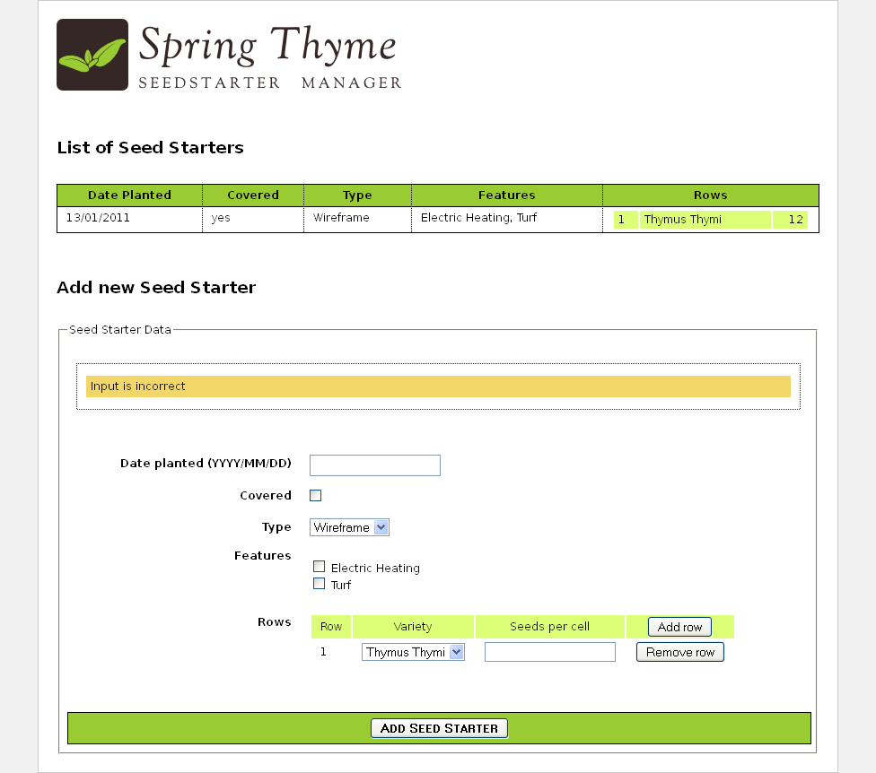

Most of the processors of the Standard Dialect are _attribute processors_. This
allows browsers to correctly display HTML template files even before
being processed because they will simply ignore the additional attributes. For
example, while a JSP using tag libraries could include a fragment of code not
directly displayable by a browser like:

```html
<form:inputText name="userName" value="${user.name}" />
```

...the Thymeleaf Standard Dialect would allow us to achieve the same
functionality with:

```html
<input type="text" name="userName" value="James Carrot" th:value="${user.name}" />
```

Not only will this be correctly displayed by browsers, but this also allows us to
(optionally) specify a value attribute in it ("James Carrot", in this case) that
will be displayed when the prototype is statically opened in a browser, and that
will be substituted by the value resulting from the evaluation of `${user.name}`
during processing of the template.

This helps your designer and developer to work on the very same template file
and reduce the effort required to transform a static prototype into a working
template file. The ability to do this is a feature called _Natural Templating_.

## It's still a Prototype!

Our application is ready now. But let's have a second look at the `.html` page
we created...

One of the nicest consequences of working with Thymeleaf is that after all this
functionality we have added to our HTML, we can still use it as a prototype (we say it is a _Natural Template_). Let's open `seedstartermng.html` directly in our browser without executing our application:



There it is! It's not a working application, it's not real data... but it is a
perfectly valid prototype made up of perfectly displayable HTML code.

For the history of the HTML standards, read [From HTML to HTML (via HTML)](../html-history/).

---

*Adapted from the Thymeleaf documentation at thymeleaf.org, licensed under [CC BY-SA 3.0](https://creativecommons.org/licenses/by-sa/3.0/): [Dialects: The Standard Dialect](https://www.thymeleaf.org/doc/tutorials/3.1/usingthymeleaf.html#dialects-the-standard-dialect), [It's still a Prototype!](https://www.thymeleaf.org/doc/tutorials/3.1/thymeleafspring.html#its-still-a-prototype).*
