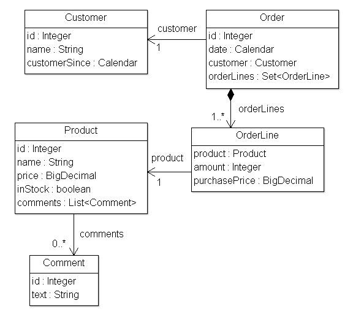
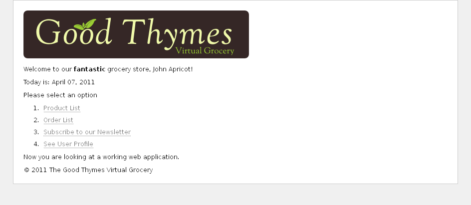

The source code for the examples shown in this, and future chapters of this
guide, can be found in the _Good Thymes Virtual Grocery (GTVG)_ example app
which has two (equivalent) versions:

   * `javax.*` based: [gtvg-javax](https://github.com/thymeleaf/thymeleaf/tree/3.1-master/examples/core/thymeleaf-examples-gtvg-javax).
   * `jakarta.*` based: [gtvg-jakarta](https://github.com/thymeleaf/thymeleaf/tree/3.1-master/examples/core/thymeleaf-examples-gtvg-jakarta).

## A website for a grocery

To better explain the concepts involved in processing templates with Thymeleaf,
this tutorial will use a demo application which you can download from the
project's web site.

This application is the web site of an imaginary virtual grocery, and will
provide us with many scenarios to showcase Thymeleaf's many features.

To start, we need a simple set of model entities for our application: `Products`
which are sold to `Customers` by creating `Orders`. We will also be managing `Comments`
about those `Products`:



Our application will also have a very simple service layer, composed by `Service`
objects containing methods like:

```java
public class ProductService {

    ...

    public List<Product> findAll() {
        return ProductRepository.getInstance().findAll();
    }

    public Product findById(Integer id) {
        return ProductRepository.getInstance().findById(id);
    }
    
}
```

At the web layer our application will have a filter that will delegate
execution to Thymeleaf-enabled commands depending on the request URL:

```java

/*
 * The application object needs to be declared first (implements IWebApplication)
 * In this case, the Jakarta-based version will be used.
 */
public void init(final FilterConfig filterConfig) throws ServletException {
    this.application =
            JakartaServletWebApplication.buildApplication(
                filterConfig.getServletContext());
    // We will see later how the TemplateEngine object is built and configured
    this.templateEngine = buildTemplateEngine(this.application);
}

/*
 * Each request will be processed by creating an exchange object (modeling
 * the request, its response and all the data needed for this process) and
 * then calling the corresponding controller.
 */
private boolean process(HttpServletRequest request, HttpServletResponse response)
        throws ServletException {
    
    try {

        final IWebExchange webExchange = 
            this.application.buildExchange(request, response);
        final IWebRequest webRequest = webExchange.getRequest();

        // This prevents triggering engine executions for resource URLs
        if (request.getRequestURI().startsWith("/css") ||
                request.getRequestURI().startsWith("/images") ||
                request.getRequestURI().startsWith("/favicon")) {
            return false;
        }
        
        /*
         * Query controller/URL mapping and obtain the controller
         * that will process the request. If no controller is available,
         * return false and let other filters/servlets process the request.
         */
        final IGTVGController controller = 
            ControllerMappings.resolveControllerForRequest(webRequest);
        if (controller == null) {
            return false;
        }

        /*
         * Write the response headers
         */
        response.setContentType("text/html;charset=UTF-8");
        response.setHeader("Pragma", "no-cache");
        response.setHeader("Cache-Control", "no-cache");
        response.setDateHeader("Expires", 0);

        /*
         * Obtain the response writer
         */
        final Writer writer = response.getWriter();

        /*
         * Execute the controller and process view template,
         * writing the results to the response writer. 
         */
        controller.process(webExchange, this.templateEngine, writer);
        
        return true;
        
    } catch (Exception e) {
        try {
            response.sendError(HttpServletResponse.SC_INTERNAL_SERVER_ERROR);
        } catch (final IOException ignored) {
            // Just ignore this
        }
        throw new ServletException(e);
    }
    
}
```

This is our `IGTVGController` interface:

```java
public interface IGTVGController {

    public void process(
            final IWebExchange webExchange, 
            final ITemplateEngine templateEngine,
            final Writer writer)
            throws Exception;
    
}
```

All we have to do now is create implementations of the `IGTVGController`
interface, retrieving data from the services and processing templates using the
`ITemplateEngine` object.

In the end, it will look like this:



But first let's see how that template engine is initialized.

The `buildTemplateEngine(...)` method is explained in [Creating and configuring the Template Engine](../../configuration/template-engine-and-resolvers/).

## A multi-language welcome

Our first task will be to create a home page for our grocery site.

The first version of this page will be extremely simple: just a title and a
welcome message. This is our `/WEB-INF/templates/home.html` file:

```html
<!DOCTYPE html>

<html xmlns:th="http://www.thymeleaf.org">

  <head>
    <title>Good Thymes Virtual Grocery</title>
    <meta http-equiv="Content-Type" content="text/html; charset=UTF-8" />
    <link rel="stylesheet" type="text/css" media="all" 
          href="../../css/gtvg.css" th:href="@{/css/gtvg.css}" />
  </head>

  <body>
  
    <p th:text="#{home.welcome}">Welcome to our grocery store!</p>
  
  </body>

</html>
```

The first thing you will notice is that this file is HTML5 that can be correctly
displayed by any browser because it does not include any non-HTML tags (browsers
ignore all attributes they don't understand, like `th:text`).

But you may also notice that this template is not really a _valid_ HTML5
document, because these non-standard attributes we are using in the `th:*` form
are not allowed by the HTML5 specification. In fact, we are even adding an `xmlns:th` 
attribute to our `<html>` tag, something absolutely non-HTML5-ish:

```html
<html xmlns:th="http://www.thymeleaf.org">
```

...which has no influence at all in template processing, but works as an
*incantation* that prevents our IDE from complaining about the lack of a
namespace definition for all those `th:*` attributes.

So what if we wanted to make this template **HTML5-valid**? Easy: switch to
Thymeleaf's data attribute syntax, using the `data-` prefix for attribute names
and hyphen (`-`) separators instead of semi-colons (`:`):

```html
<!DOCTYPE html>

<html>

  <head>
    <title>Good Thymes Virtual Grocery</title>
    <meta http-equiv="Content-Type" content="text/html; charset=UTF-8" />
    <link rel="stylesheet" type="text/css" media="all" 
          href="../../css/gtvg.css" data-th-href="@{/css/gtvg.css}" />
  </head>

  <body>
  
    <p data-th-text="#{home.welcome}">Welcome to our grocery store!</p>
  
  </body>

</html>
```

Custom `data-` prefixed attributes are allowed by the HTML5 specification, so,
with this code above, our template would be a *valid HTML5 document*.

> Both notations are completely equivalent and interchangeable, but for the sake
> of simplicity and compactness of the code samples, this tutorial will use the
> *namespace notation* (`th:*`). Also, the `th:*` notation is more general and
> allowed in every Thymeleaf template mode (`XML`, `TEXT`...) whereas the `data-`
> notation is only allowed in `HTML` mode.

## Contexts

In order to process our template, we will create a `HomeController` class
implementing the `IGTVGController` interface we saw before:

```java
public class HomeController implements IGTVGController {

    public void process(
            final IWebExchange webExchange, 
            final ITemplateEngine templateEngine,
            final Writer writer)
            throws Exception {
        
        WebContext ctx = new WebContext(webExchange, webExchange.getLocale());
        
        templateEngine.process("home", ctx, writer);
        
    }

}
```

The first thing we see is the creation of a *context*. A Thymeleaf context is an
object implementing the `org.thymeleaf.context.IContext` interface. Contexts
should contain all the data required for an execution of the template engine in
a variables map, and also reference the locale that must be used for
externalized messages.

```java
public interface IContext {

    public Locale getLocale();
    public boolean containsVariable(final String name);
    public Set<String> getVariableNames();
    public Object getVariable(final String name);
    
}
```

There is a specialized extension of this interface, `org.thymeleaf.context.IWebContext`,
meant to be used in web applications.

```java
public interface IWebContext extends IContext {
    
    public IWebExchange getExchange();
    
}
```

The Thymeleaf core library offers an implementation of each of these interfaces:

 * `org.thymeleaf.context.Context` implements `IContext`
 * `org.thymeleaf.context.WebContext` implements `IWebContext`

And as you can see in the controller code, `WebContext` is the one we use. In
fact we have to, because the use of a `WebApplicationTemplateResolver` requires
that we use a context implementing `IWebContext`.

```java
WebContext ctx = new WebContext(webExchange, webExchange.getLocale());
```

The `WebContext` constructor requires information contained in the `IWebExchange`
abstraction object that was created at the filter representing this
web-based interchange (i.e. request + response). The default locale of the
system will be used if none is specified (although you
should never let this happen in real applications).

There are some specialized expressions that we will be able to use to obtain the
request parameters and the request, session and application attributes from the
`WebContext` in our templates. For example:

 * `${x}` will return a variable `x` stored into the Thymeleaf context or as an *exchange attribute* (A *"request attribute"* in Servlet jargon).
 * `${param.x}` will return a *request parameter* called `x` (which might be multivalued).
 * `${session.x}` will return a *session attribute* called `x`.
 * `${application.x}` will return an *application attribute* called `x` (a *"servlet context attribute"* in Servlet jargon).

## Executing the template engine

With our context object ready, now we can tell the template engine to process
the template (by its name) using the context, and passing it a response writer
so that the response can be written to it:

```java
templateEngine.process("home", ctx, writer);
```

Let's see the results of this using the Spanish locale:

```html
<!DOCTYPE html>

<html>

  <head>
    <title>Good Thymes Virtual Grocery</title>
    <meta content="text/html; charset=UTF-8" http-equiv="Content-Type"/>
    <link rel="stylesheet" type="text/css" media="all" href="/gtvg/css/gtvg.css" />
  </head>

  <body>
  
    <p>¡Bienvenido a nuestra tienda de comestibles!</p>

  </body>

</html>
```

## Some more pages for our grocery

Now we know a lot about using Thymeleaf, we can add some new pages to our
website for order management.

Note that we will focus on HTML code, but you can have a look at the bundled
source code if you want to see the corresponding controllers.

### Order List

Let's start by creating an order list page, `/WEB-INF/templates/order/list.html`:

```html
<!DOCTYPE html>

<html xmlns:th="http://www.thymeleaf.org">

  <head>

    <title>Good Thymes Virtual Grocery</title>
    <meta http-equiv="Content-Type" content="text/html; charset=UTF-8" />
    <link rel="stylesheet" type="text/css" media="all" 
          href="../../../css/gtvg.css" th:href="@{/css/gtvg.css}" />
  </head>

  <body>

    <h1>Order list</h1>
  
    <table>
      <tr>
        <th>DATE</th>
        <th>CUSTOMER</th>
        <th>TOTAL</th>
        <th></th>
      </tr>
      <tr th:each="o : ${orders}" th:class="${oStat.odd}? 'odd'">
        <td th:text="${#calendars.format(o.date,'dd/MMM/yyyy')}">13 jan 2011</td>
        <td th:text="${o.customer.name}">Frederic Tomato</td>
        <td th:text="${#aggregates.sum(o.orderLines.{purchasePrice * amount})}">23.32</td>
        <td>
          <a href="details.html" th:href="@{/order/details(orderId=${o.id})}">view</a>
        </td>
      </tr>
    </table>
  
    <p>
      <a href="../home.html" th:href="@{/}">Return to home</a>
    </p>
    
  </body>
  
</html>
```

There's nothing here that should surprise us, except for this little bit of OGNL
magic:

```html
<td th:text="${#aggregates.sum(o.orderLines.{purchasePrice * amount})}">23.32</td>
```

What that does is, for each order line (`OrderLine` object) in the order,
multiply its `purchasePrice` and `amount` properties (by calling the
corresponding `getPurchasePrice()` and `getAmount()` methods) and return the
result into a list of numbers, later aggregated by the `#aggregates.sum(...)`
function in order to obtain the order total price.

You've got to love the power of OGNL.

### Order Details

Now for the order details page, in which we will make a heavy use of asterisk
syntax:

```html
<!DOCTYPE html>

<html xmlns:th="http://www.thymeleaf.org">

  <head>
    <title>Good Thymes Virtual Grocery</title>
    <meta http-equiv="Content-Type" content="text/html; charset=UTF-8" />
    <link rel="stylesheet" type="text/css" media="all" 
          href="../../../css/gtvg.css" th:href="@{/css/gtvg.css}" />
  </head>

  <body th:object="${order}">

    <h1>Order details</h1>

    <div>
      <p><b>Code:</b> <span th:text="*{id}">99</span></p>
      <p>
        <b>Date:</b>
        <span th:text="*{#calendars.format(date,'dd MMM yyyy')}">13 jan 2011</span>
      </p>
    </div>

    <h2>Customer</h2>

    <div th:object="*{customer}">
      <p><b>Name:</b> <span th:text="*{name}">Frederic Tomato</span></p>
      <p>
        <b>Since:</b>
        <span th:text="*{#calendars.format(customerSince,'dd MMM yyyy')}">1 jan 2011</span>
      </p>
    </div>
  
    <h2>Products</h2>
  
    <table>
      <tr>
        <th>PRODUCT</th>
        <th>AMOUNT</th>
        <th>PURCHASE PRICE</th>
      </tr>
      <tr th:each="ol,row : *{orderLines}" th:class="${row.odd}? 'odd'">
        <td th:text="${ol.product.name}">Strawberries</td>
        <td th:text="${ol.amount}" class="number">3</td>
        <td th:text="${ol.purchasePrice}" class="number">23.32</td>
      </tr>
    </table>

    <div>
      <b>TOTAL:</b>
      <span th:text="*{#aggregates.sum(orderLines.{purchasePrice * amount})}">35.23</span>
    </div>
  
    <p>
      <a href="list.html" th:href="@{/order/list}">Return to order list</a>
    </p>

  </body>
  
</html>
```

Not much really new here, except for this nested object selection:

```html
<body th:object="${order}">

  ...

  <div th:object="*{customer}">
    <p><b>Name:</b> <span th:text="*{name}">Frederic Tomato</span></p>
    ...
  </div>

  ...
</body>
```

...which makes that `*{name}` equivalent to:

```html
<p><b>Name:</b> <span th:text="${order.customer.name}">Frederic Tomato</span></p>
```

---

*Adapted from the Thymeleaf documentation at thymeleaf.org, licensed under [CC BY-SA 3.0](https://creativecommons.org/licenses/by-sa/3.0/): [The Good Thymes Virtual Grocery](https://www.thymeleaf.org/doc/tutorials/3.1/usingthymeleaf.html#the-good-thymes-virtual-grocery), [A multi-language welcome](https://www.thymeleaf.org/doc/tutorials/3.1/usingthymeleaf.html#a-multi-language-welcome), [Contexts](https://www.thymeleaf.org/doc/tutorials/3.1/usingthymeleaf.html#contexts), [Executing the template engine](https://www.thymeleaf.org/doc/tutorials/3.1/usingthymeleaf.html#executing-the-template-engine), [Some more pages for our grocery](https://www.thymeleaf.org/doc/tutorials/3.1/usingthymeleaf.html#some-more-pages-for-our-grocery).*
