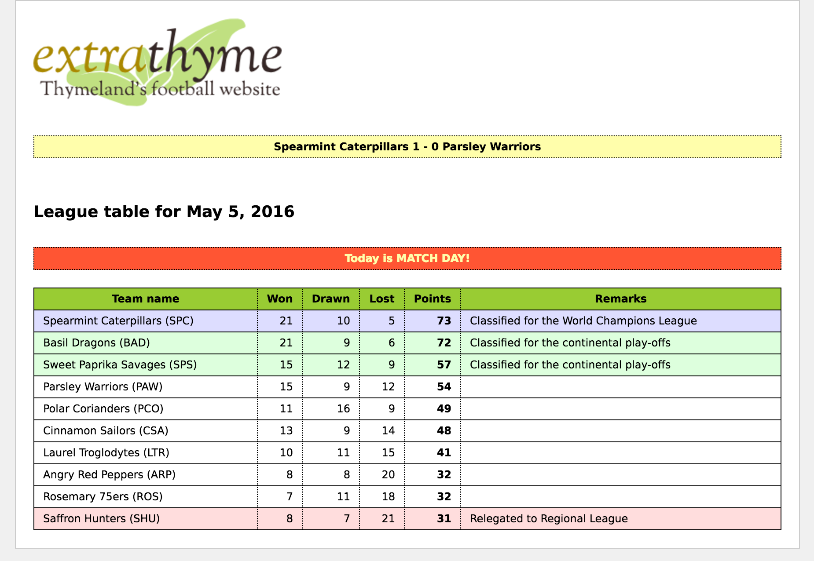

The source code for the examples shown in this and future chapters of this guide
can be found in the _extraThyme_ example application:

   * [Spring 5 extraThyme](https://github.com/thymeleaf/thymeleaf/tree/3.1-master/examples/spring5/thymeleaf-examples-spring5-extrathyme).
   * [Spring 6 extraThyme](https://github.com/thymeleaf/thymeleaf/tree/3.1-master/examples/spring6/thymeleaf-examples-spring6-extrathyme).

## extraThyme: a website for Thymeland's football league

Football is a popular sport in Thymeland[^1].
There is a 10-team league going on
there each season, and its organizers have just asked us to create a website for
it called "extraThyme".

This website will be very simple: just a table with:

 * The team names.
 * How many matches they won, drew or lost, as well as the total points earned.
 * A remark explaining whether their position in the table qualifies them for
   higher-level competitions next year or else mean their relegation to regional
   leagues.

Above the league table, a banner will be displaying headlines with the
results of recent matches, and also there will be a clearly visible banner 
that warns users every Sunday that Sundays are match days, and therefore 
they should be going to the stadium instead of browsing the internet.



We will use HTML5, Spring MVC and the SpringStandard dialect for our application,
and we will be extending Thymeleaf by creating a `score` dialect that includes:

 * A `score:remarkforposition` attribute that outputs internationalized text
   for the Remarks column in the table. This text should explain whether the
   team's position in the table qualifies it for the World Champions League, the
   Continental Play-Offs, or relegates it to the Regional League.
 * A `score:classforposition` attribute that establishes a CSS class for the
   table rows depending on the team's remarks: blue background for the World
   Champions League, green for the Continental Play-Offs, and red for relegation.
 * A `score:headlines` tag for drawing the yellow box at the top with the
   results of recent matches. This tag should support an order attribute with
   values random (for showing a randomly selected match) and `latest` (default,
   for showing only the last match).
 * A `score:match-day-today` attribute that can be added to the league table
   header in order to (conditionally, if it is Sunday) add a banner warning the
   user that today is a match day.

Our markup will therefore look like this, making use of both `th` and `score`
attributes:

```html
<!DOCTYPE html>

<!--/* Note the xmlns:* here are completely optional and only meant to     */-->
<!--/* avoid IDEs from complaining about tags/attributes they may not know */-->
<html xmlns:th="http://www.thymeleaf.org" xmlns:score="http://thymeleafexamples">

  <head>
    <title>extraThyme: Thymeland's football website</title>
    <meta http-equiv="Content-Type" content="text/html; charset=UTF-8" />
    <link rel="stylesheet" type="text/css" media="all"
          href="../../css/extrathyme.css" th:href="@{/css/extrathyme.css}"/>
  </head>

  <body>

    <div>
      
    </div>

    <score:headlines order="random" />

    <div class="leaguetable">

      <h2 score:match-day-today th:text="#{title.leaguetable(${execInfo.now.time})}">
        League table for 07 July 2011
      </h2>
      
      <table>
        <thead>
          <tr>
            <th th:text="#{team.name}">Team</th>
            <th th:text="#{team.won}" class="matches">Won</th>
            <th th:text="#{team.drawn}" class="matches">Drawn</th>
            <th th:text="#{team.lost}" class="matches">Lost</th>
            <th th:text="#{team.points}" class="points">Points</th>
            <th th:text="#{team.remarks}">Remarks</th>
          </tr>
        </thead>
        <tbody>
          <tr th:each="t : ${teams}" score:classforposition="${tStat.count}">
            <td th:text="|${t.name} (${t.code})|">The Winners (TWN)</td>
            <td th:text="${t.won}" class="matches">1</td>
            <td th:text="${t.drawn}" class="matches">0</td>
            <td th:text="${t.lost}" class="matches">0</td>
            <td th:text="${t.points}" class="points">3</td>
            <td score:remarkforposition="${tStat.count}">Great winner!</td>
          </tr>
          <!--/*-->
          <tr>
            <td>The First Losers (TFL)</td>
            <td class="matches">0</td>
            <td class="matches">1</td>
            <td class="matches">0</td>
            <td class="points">1</td>
            <td>Little loser!</td>
          </tr>
          <tr>
            <td>The Last Losers (TLL)</td>
            <td class="matches">0</td>
            <td class="matches">0</td>
            <td class="matches">1</td>
            <td class="points">0</td>
            <td>Big loooooser</td>
          </tr>
          <!--*/-->
        </tbody>
      </table>

    </div>

  </body>

</html>
```      

_(Note that we've added a second and third rows to our table, surrounded by parser-level comments `<!--/* ... */-->` so 
that our template shows nicely as a prototype when directly opened in a browser.)_

## Changing the CSS class by team position

The first attribute processor we will develop will be `ClassForPositionAttributeTagProcessor`,
which we will implement as a subclass of a convenience abstract class provided
by Thymeleaf called `AbstractAttributeTagProcessor`.

This abstract class is the base for all tag processors (i.e. processors that act on *tag* events and not *models*) 
which match (i.e. are selected for execution) based on the existence of a specific attribute
in such tag. In this case, `score:classforposition`.

The idea is that we will use this processor for setting a new value to the `class` attribute of the tag
`score:classforposition` is living in.

Let's have a look at our code:

```java
public class ClassForPositionAttributeTagProcessor extends AbstractAttributeTagProcessor {

    private static final String ATTR_NAME = "classforposition";
    private static final int PRECEDENCE = 10000;


    public ClassForPositionAttributeTagProcessor(final String dialectPrefix) {
        super(
            TemplateMode.HTML, // This processor will apply only to HTML mode
            dialectPrefix,     // Prefix to be applied to name for matching
            null,              // No tag name: match any tag name
            false,             // No prefix to be applied to tag name
            ATTR_NAME,         // Name of the attribute that will be matched
            true,              // Apply dialect prefix to attribute name
            PRECEDENCE,        // Precedence (inside dialect's own precedence)
            true);             // Remove the matched attribute afterwards
    }


    @Override
    protected void doProcess(
            final ITemplateContext context, final IProcessableElementTag tag,
            final AttributeName attributeName, final String attributeValue,
            final IElementTagStructureHandler structureHandler) {

        final IEngineConfiguration configuration = context.getConfiguration();

        /*
         * Obtain the Thymeleaf Standard Expression parser
         */
        final IStandardExpressionParser parser =
                StandardExpressions.getExpressionParser(configuration);

        /*
         * Parse the attribute value as a Thymeleaf Standard Expression
         */
        final IStandardExpression expression = parser.parseExpression(context, attributeValue);

        /*
         * Execute the expression just parsed
         */
        final Integer position = (Integer) expression.execute(context);

        /*
         * Obtain the remark corresponding to this position in the league table.
         */
        final Remark remark = RemarkUtil.getRemarkForPosition(position);

        /*
         * Select the adequate CSS class for the element.
         */
        final String newValue;
        if (remark == Remark.WORLD_CHAMPIONS_LEAGUE) {
            newValue = "wcl";
        } else if (remark == Remark.CONTINENTAL_PLAYOFFS) {
            newValue = "cpo";
        } else if (remark == Remark.RELEGATION) {
            newValue = "rel";
        } else {
            newValue = null;
        }

        /*
         * Set the new value into the 'class' attribute (maybe appending to an existing value)
         */
        if (newValue != null) {
            String currentClass = tag.getAttribute("class").getValue();
            if (currentClass != null) {
                structureHandler.setAttribute("class", currentClass + " " + newValue);
            } else {
                structureHandler.setAttribute("class", newValue);
            }
        }

    }

}
```

The basic logic flow is easy to see and understand: get the value of the attribute, use it
for computing what we need, and finally use the `structureHandler` to instruct the engine
about the modifications needed as a result.

It is important to note that we are creating this attribute with the ability of
executing expressions written in the Standard Syntax (used by both the _Standard_
and the _SpringStandard_ dialects). This is, the ability to be set values like `${var}`,
`#{messageKey}`, conditionals, etc. See how we use this in our template:

```html
<tr th:each="t : ${teams}" score:classforposition="${tStat.count}">
```

In order to evaluate these expressions (also called _Thymeleaf Standard Expressions_) we need to first obtain the Standard Expression Parser, then parse the attribute value, and finally execute the parsed expresion:

```java
final IStandardExpressionParser parser =
        StandardExpressions.getExpressionParser(configuration);

final IStandardExpression expression = parser.parseExpression(context, attributeValue);

final Integer position = (Integer) expression.execute(context);
```

It's also interesting the way we use the `structureHandler` to add a new attribute to the
host tag (remember the `tag` object is immutable):

```java
if (newValue != null) {
    String currentClass = tag.getAttribute("class").getValue();
    if (currentClass != null) {
        structureHandler.setAttribute("class", currentClass + " " + newValue);
    } else {
        structureHandler.setAttribute("class", newValue);
    }
}
```

Last, note that **HTML-escaping texts and attribute is our responsibility**, but in this case
we know all the possible values of the `newValue` variable and they require no escaping, so
for the sake of simplicity we are skipping that operation.

## Displaying an internationalized remark

The next thing to do is creating an attribute processor able to display the remark text. This 
will be very similar to the `ClassForPositionAttrProcessor`, but with a couple of important differences:

 * We will not be setting a value for an attribute in the host tag, but rather the text body (content) of 
   the tag, in the same way a `th:text` attribute does.
 * We need to access the message externalization (internationalization) system from our code so that we 
   can display the text corresponding to the selected locale.

We will be using the same `AbstractAttributeTagProcessor` base class. And this will be our code:

```java
public class RemarkForPositionAttributeTagProcessor extends AbstractAttributeTagProcessor {

    private static final String ATTR_NAME = "remarkforposition";
    private static final int PRECEDENCE = 12000;


    public RemarkForPositionAttributeTagProcessor(final String dialectPrefix) {
        super(
            TemplateMode.HTML, // This processor will apply only to HTML mode
            dialectPrefix,     // Prefix to be applied to name for matching
            null,              // No tag name: match any tag name
            false,             // No prefix to be applied to tag name
            ATTR_NAME,         // Name of the attribute that will be matched
            true,              // Apply dialect prefix to attribute name
            PRECEDENCE,        // Precedence (inside dialect's precedence)
            true);             // Remove the matched attribute afterwards
    }


    @Override
    protected void doProcess(
            final ITemplateContext context, final IProcessableElementTag tag,
            final AttributeName attributeName, final String attributeValue,
            final IElementTagStructureHandler structureHandler) {

        final IEngineConfiguration configuration = context.getConfiguration();

        /*
         * Obtain the Thymeleaf Standard Expression parser
         */
        final IStandardExpressionParser parser =
                StandardExpressions.getExpressionParser(configuration);

        /*
         * Parse the attribute value as a Thymeleaf Standard Expression
         */
        final IStandardExpression expression =
                parser.parseExpression(context, attributeValue);

        /*
         * Execute the expression just parsed
         */
        final Integer position = (Integer) expression.execute(context);

        /*
         * Obtain the remark corresponding to this position in the league table
         */
        final Remark remark = RemarkUtil.getRemarkForPosition(position);
        
        /*
         * If no remark is to be applied, just set an empty body to this tag
         */
        if (remark == null) {
            structureHandler.setBody("", false); // false == 'non-processable'
            return;
        }
        
        /*
         * Message should be internationalized, so we ask the engine to resolve
         * the message 'remarks.{REMARK}' (e.g. 'remarks.RELEGATION'). No
         * parameters are needed for this message.
         *
         * Also, we will specify to "use absent representation" so that, if this
         * message entry didn't exist in our resource bundles, an absent-message
         * label will be shown.
         */
        final String i18nMessage =
                context.getMessage(
                        RemarkForPositionAttributeTagProcessor.class, 
                        "remarks." + remark.toString(), 
                        new Object[0], 
                        true);

        /*
         * Set the computed message as the body of the tag, HTML-escaped and
         * non-processable (hence the 'false' argument)
         */
        structureHandler.setBody(HtmlEscape.escapeHtml5(i18nMessage), false);
        
    }

}
```

### Accessing i18n messages

Note that we are accessing the message externalization system with:

```java
final String i18nMessage =
        context.getMessage(
                RemarkForPositionAttributeTagProcessor.class, 
                "remarks." + remark.toString(), 
                new Object[0], 
                true);
```

This will call the message resolution mechanism configured at the engine, passing
not only the specific key we are interested on and its parameters (none, in this case), but
also two other pieces of information:

  * The *origin* to be assigned to the message: `RemarkForPositionAttributeTagProcessor.class`
  * Whether an *absent message representation* should be used (`true`)

Message resolution is an **extension point** in Thymeleaf (`IMessageResolver` interface), and
therefore how these parameters are treated depends on the specific implementation being used.
The default implementation in non-Spring-enabled applications (`StandardMessageResolver`) 
will do the following:

  * First look for `.properties` files with the same name as the template file + the locale. So
    if the template is `/views/main.html` and locale is `gl_ES`, it will look for
    `/views/main_gl_ES.properties`, then `/views/main_gl.properties` and last
    `/views/main.properties`.
  * If not found, then use the *origin* class (which could have been specified `null`) and look
    for `.properties` files in classpath with the name of the class specified there (the
    processor's own class): `classpath:org/thymeleaf/examples/spring6/extrathyme/dialects/score/RemarkForPositionAttributeTagProcessor_gl_ES.properties`,
    etc. This allows the *componentization* or processors and dialects with their whole set of
    i18n resource bundles in plain old `.jar` files.
  * If none of these are found, have a look at the *absent message representation* flag. If `false`,
    simply return `null`. If `true`, create some kind of text that will allow the developer or user
    to quickly identify the fact that an i18n resource is missing: `??remarks.rel_gl_ES??`.

_(Note that, in Spring-enabled applications, this message resolution mechanism will be replaced by default
with Spring's own, based on the `MessageSource` beans declared at the Spring Application Context.)_

### HTML-escaping content

Also, in this processor we are performing the required HTML-escaping of the content we are setting
by using the `HtmlEscape` class from the [Unbescape](http://unbescape.org) library, used for this
purpose throughout Thymeleaf:

```java
structureHandler.setBody(HtmlEscape.escapeHtml5(i18nMessage), false);
```

## An element processor for our headlines

The third processor we will write is an element (tag) processor. Note we call this an *element tag processor*
in contrast with the two previous processors, which were *attribute tag processors*. The reason is, in this case
we want our processor to match (i.e. to be selected for execution) based on the **name of the tag**, not
on the name of one of its attributes.

This kind of tag processor has one advantage and also one disadvantage with
respect to attribute tag processors:

 * Advantage: elements can contain multiple attributes, and so your element processors can receive a richer and 
   more complex set of configuration parameters.
 * Disadvantage: custom elements/tags are unknown to browsers, and so if you are developing a web application 
   using custom tags you might have to sacrifice one of the most interesting features of Thymeleaf: the ability 
   to statically display templates as prototypes (_natural templating_).

This processor will extend `AbstractElementTagProcessor`, the base class to be used for tag processors that
do not match on a specific attribute:

```java
public class HeadlinesElementTagProcessor extends AbstractElementTagProcessor {

    private static final String TAG_NAME = "headlines";
    private static final int PRECEDENCE = 1000;


    private final Random rand = new Random(System.currentTimeMillis());


    public HeadlinesElementTagProcessor(final String dialectPrefix) {
        super(
            TemplateMode.HTML, // This processor will apply only to HTML mode
            dialectPrefix,     // Prefix to be applied to name for matching
            TAG_NAME,          // Tag name: match specifically this tag
            true,              // Apply dialect prefix to tag name
            null,              // No attribute name: will match by tag name
            false,             // No prefix to be applied to attribute name
            PRECEDENCE);       // Precedence (inside dialect's own precedence)
    }


    @Override
    protected void doProcess(
            final ITemplateContext context, final IProcessableElementTag tag,
            final IElementTagStructureHandler structureHandler) {

        /*
         * Obtain the Spring application context.
         */
        final ApplicationContext appCtx = SpringContextUtils.getApplicationContext(context);

        /*
         * Obtain the HeadlineRepository bean from the application context, and ask
         * it for the current list of headlines.
         */
        final HeadlineRepository headlineRepository = appCtx.getBean(HeadlineRepository.class);
        final List<Headline> headlines = headlineRepository.findAllHeadlines();

        /*
         * Read the 'order' attribute from the tag. This optional attribute in our tag 
         * will allow us to determine whether we want to show a random headline or
         * only the latest one ('latest' is default).
         */
        final String order = tag.getAttributeValue("order");

        String headlineText = null;
        if (order != null && order.trim().toLowerCase().equals("random")) {
            // Order is random 

            final int r = this.rand.nextInt(headlines.size());
            headlineText = headlines.get(r).getText();
            
        } else {
            // Order is "latest", only the latest headline will be shown
            
            Collections.sort(headlines);
            headlineText = headlines.get(headlines.size() - 1).getText();
            
        }

        /*
         * Create the DOM structure that will be substituting our custom tag.
         * The headline will be shown inside a '<div>' tag, and so this must
         * be created first and then a Text node must be added to it.
         */
        final IModelFactory modelFactory = context.getModelFactory();

        final IModel model = modelFactory.createModel();

        model.add(modelFactory.createOpenElementTag("div", "class", "headlines"));
        model.add(modelFactory.createText(HtmlEscape.escapeHtml5(headlineText)));
        model.add(modelFactory.createCloseElementTag("div"));

        /*
         * Instruct the engine to replace this entire element with the specified model.
         */
        structureHandler.replaceWith(model, false);
        
    }

}
```

The first interesting part of the code above is showing how to access Spring's `ApplicationContext`
in order to obtain one of our beans from it (the `HeadlineRepository`):

```java
final ApplicationContext appCtx = SpringContextUtils.getApplicationContext(context);
```

Also, this processor is different to the previous ones in that we will need to *create markup* as 
a result of its execution: we are going to replace the original `<score:headlines .../>` tag with
a `<div>...</div>` fragment, so we will need to make use of the **model factory**.

### The Model Factory

The model factory is a special object available to processors (and other
structures such as pre-processors, post-processors, etc.) that can create new
instances of *events* as *models* (fragments of templates), and also new
instances of *models* themselves.

It is therefore the tool for creating new markup, like we can see in the code
above:

```java
final IModelFactory modelFactory = context.getModelFactory();

final IModel model = modelFactory.createModel();

model.add(modelFactory.createOpenElementTag("div", "class", "headlines"));
model.add(modelFactory.createText(HtmlEscape.escapeHtml5(headlineText)));
model.add(modelFactory.createCloseElementTag("div"));
```

Note how markup events needs to be created *one event at a time*, and how the open and close tags for the same `div`
element have to be created separately and in the correct order. This is because models are *sequences of
events* and not nodes in a Document Object Model (DOM).

The model factory offers a quite complete set of methods for creating all types of events: tags, texts, DOCTYPEs... and
also useful methods for modifying the attributes in a tag (by creating a new `tag` instance, given they are immutable),
such as:

```java
final IOpenElementTag newTag = modelFactory.setAttribute(tag, "class", "newvalue");
```

Also, the model factory is able to create `IModel` instances from scratch (like the `modelFactory.createModel()` above),
from a single existing event, and also from a piece of markup that we want to convert into its corresponding sequence
of events by *parsing* it:

```java
final IModel model = 
        modelFactory.parse(
                context.getTemplateData(), 
                "<div class='headlines'>Some headlines</div>");
```

## A model processor for our "Match Day Today" banner

The last processor we will include in our dialect is of a different nature than the ones we've seen so
far: it is a **model processor**, not a *tag processor*.

As already mentioned in a previous section, model processors do not execute on a
specific tag event, but on the complete sequence of events (i.e. the *model*)
that contains the entire element they are matching.

So if we have a model processor that matches `<p>` tags with attribute `score:matcher`, and a fragment of
template such as:

```html
<p score:matcher="whatever">
    This is some body
</p>
```

That *model processor* will receive as an argument of its `doProcess()` method
an `IModel` containing 3 events: `<p score:matcher="whatever">` (open tag), 
`\n    This is some body\n` (text) and `</p>` (close tag).

So back to our requirements: we wanted a model processor matching a
`score:match-day-today`, that we can apply to the league table header and 
make it display, below this header, a banner warning the user that sundays are match days:

```html
<h2 score:match-day-today th:text="#{title.leaguetable(${execInfo.now.time})}">
    League table for 07 July 2011
</h2>
```

Note that we don't need a value for this `score:match-day-today` attribute, so
we can just ignore it. Our code will look like this:

```java
public class MatchDayTodayModelProcessor extends AbstractAttributeModelProcessor {

    private static final String ATTR_NAME = "match-day-today";
    private static final int PRECEDENCE = 100;


    public MatchDayTodayModelProcessor(final String dialectPrefix) {
        super(
            TemplateMode.HTML, // This processor will apply only to HTML mode
            dialectPrefix,     // Prefix to be applied to name for matching
            null,              // No tag name: match any tag name
            false,             // No prefix to be applied to tag name
            ATTR_NAME,         // Name of the attribute that will be matched
            true,              // Apply dialect prefix to attribute name
            PRECEDENCE,        // Precedence (inside dialect's own precedence)
            true);             // Remove the matched attribute afterwards
    }


    protected void doProcess(
            final ITemplateContext context, final IModel model,
            final AttributeName attributeName, final String attributeValue,
            final IElementModelStructureHandler structureHandler) {


        if (!checkPositionInMarkup(context)) {
            throw new TemplateProcessingException(
                    "The " + ATTR_NAME + " attribute can only be used inside a " +
                    "markup element with class \"leaguetable\"");
        }

        final Calendar now = Calendar.getInstance(context.getLocale());
        final int dayOfWeek = now.get(Calendar.DAY_OF_WEEK);

        // Sundays are Match Days!!
        if (dayOfWeek == Calendar.SUNDAY) {

            // The Model Factory will allow us to create new events
            final IModelFactory modelFactory = context.getModelFactory();

            // We will be adding the "Today is Match Day" banner just after
            // the element we are processing for:
            //
            // <h4 class="matchday">Today is MATCH DAY!</h4>
            //
            model.add(modelFactory.createOpenElementTag("h4", "class", "matchday")); //
            model.add(modelFactory.createText("Today is MATCH DAY!"));
            model.add(modelFactory.createCloseElementTag("h4"));

        }

    }


    private static boolean checkPositionInMarkup(final ITemplateContext context) {

        /*
         * We want to make sure this processor is being applied inside a container tag which has
         * class="leaguetable". So we need to check the second-to-last entry in the element stack
         * (the last entry is the tag being processed itself).
         */

        final List<IProcessableElementTag> elementStack = context.getElementStack();
        if (elementStack.size() < 2) {
            return false;
        }

        final IProcessableElementTag container = elementStack.get(elementStack.size() - 2);
        if (!(container instanceof IOpenElementTag)) {
            return false;
        }

        final String classValue = container.getAttributeValue("class");
        return classValue != null && classValue.equals("leaguetable");

    }


}
```

The first thing to note is that we are performing a check on the position the attribute
is being used at: we will only allow it inside a container with `class="leaguetable"`. So
our `checkPositionInMarkup(...)` method makes use of the *element stack* in order to
know the list of tags that had to be processed in order to process the current one.

Also, regarding the way the new banner element is created (an `<h4>`) notice how what
we are doing is modifying the `model` attribute passed as an argument to `doProcess(...)`.
No new model object is being created:

```java
final IModelFactory modelFactory = context.getModelFactory();

model.add(modelFactory.createOpenElementTag("h4", "class", "matchday")); //
model.add(modelFactory.createText("Today is MATCH DAY!"));
model.add(modelFactory.createCloseElementTag("h4"));
```

## Declaring it all: the Dialect

The last step we need to take in order to complete our dialect is, of course,
the dialect class itself.

As seen in a previous section, dialects might implement different interfaces
depending on what they provide to the template engine. In this case, our dialect
is only providing processors so it will be implementing `IProcessorDialect`.

In fact, we will extend an abstract convenience implementation that will ease
the implementation of the interface: `AbstractProcessorDialect`:

```java
public class ScoreDialect extends AbstractProcessorDialect {

    private static final String DIALECT_NAME = "Score Dialect";


    public ScoreDialect() {
        // We will set this dialect the same "dialect processor" precedence as
        // the Standard Dialect, so that processor executions can interleave.
        super(DIALECT_NAME, "score", StandardDialect.PROCESSOR_PRECEDENCE);
    }

    /*
     * Two attribute processors are declared: 'classforposition' and
     * 'remarkforposition'. Also one element processor: the 'headlines'
     * tag.
     */
    public Set<IProcessor> getProcessors(final String dialectPrefix) {
        final Set<IProcessor> processors = new HashSet<IProcessor>();
        processors.add(new ClassForPositionAttributeTagProcessor(dialectPrefix));
        processors.add(new RemarkForPositionAttributeTagProcessor(dialectPrefix));
        processors.add(new HeadlinesElementTagProcessor(dialectPrefix));
        processors.add(new MatchDayTodayModelProcessor(dialectPrefix));
        // This will remove the xmlns:score attributes we might add for IDE validation
        processors.add(new StandardXmlNsTagProcessor(TemplateMode.HTML, dialectPrefix));
        return processors;
    }


}
```

Once our dialect is created, we will need to add it to our Template Engine object
in order to use it. This being a Spring-enabled application, we will modify
the declared template engine bean:

```java
@Bean
public SpringTemplateEngine templateEngine(){
    SpringTemplateEngine templateEngine = new SpringTemplateEngine();
    templateEngine.setTemplateResolver(templateResolver());
    templateEngine.addDialect(new ScoreDialect());
    return templateEngine;
}
```

Note that the `addDialect(...)` call there will add the Score Dialect to the one
already configured by default in a `SpringTemplateEngine`: the SpringStandard dialect.

And that's it! Our dialect is ready to run now, and our league table will
display in exactly the way we wanted.

[^1]: European football, of course ;-)

---

*Adapted from the [Thymeleaf documentation](https://www.thymeleaf.org/doc/tutorials/3.1/extendingthymeleaf.html#creating-our-own-dialect) at thymeleaf.org, licensed under [CC BY-SA 3.0](https://creativecommons.org/licenses/by-sa/3.0/).*
