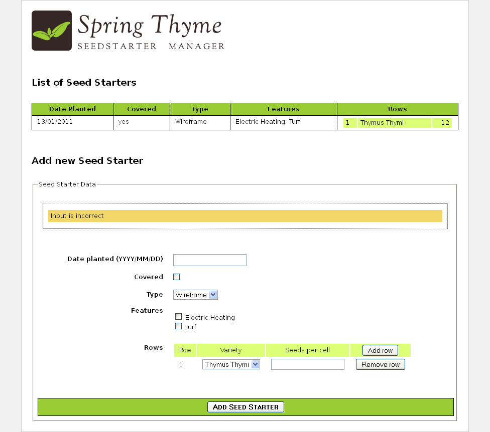

Our application is ready now. But let's have a second look at the `.html` page
we created...

One of the nicest consequences of working with Thymeleaf is that after all this
functionality we have added to our HTML, we can still use it as a prototype (we say it is a _Natural Template_). Let's open `seedstartermng.html` directly in our browser without executing our application:

There it is! It's not a working application, it's not real data... but it is a
perfectly valid prototype made up of perfectly displayable HTML code.

---

*Adapted from the [Thymeleaf documentation](https://www.thymeleaf.org/doc/tutorials/3.1/thymeleafspring.html#its-still-a-prototype) at thymeleaf.org, licensed under [CC BY-SA 3.0](https://creativecommons.org/licenses/by-sa/3.0/).*
