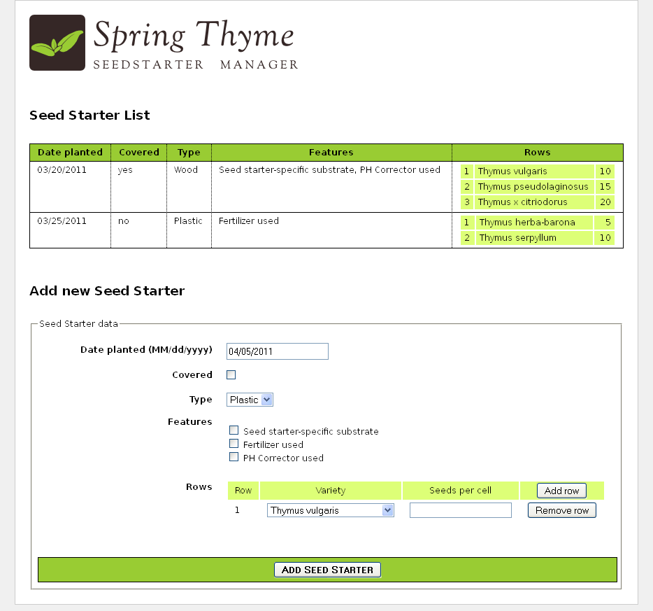
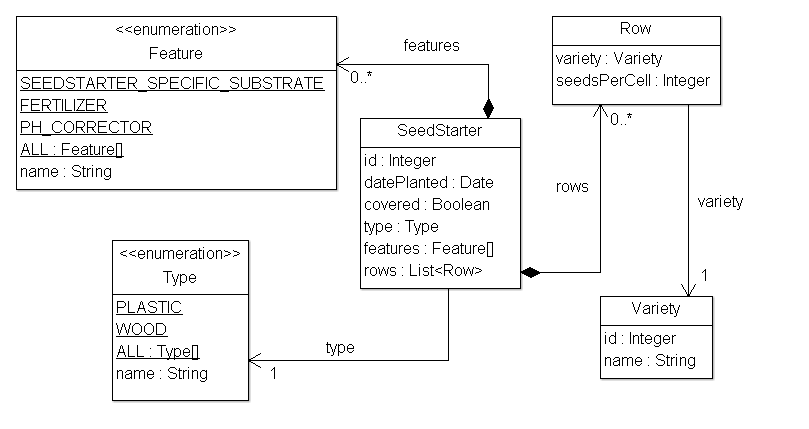

The source code for the examples shown in this and future chapters of this guide
can be found in the _Spring Thyme Seed Starter Manager (STSM)_ example app:

   * [Spring 5 STSM](https://github.com/thymeleaf/thymeleaf/tree/3.1-master/examples/spring5/thymeleaf-examples-spring5-stsm).
   * [Spring 6 STSM](https://github.com/thymeleaf/thymeleaf/tree/3.1-master/examples/spring6/thymeleaf-examples-spring6-stsm).

## The Concept

At Thymeleaf we're huge fans of thyme, and every spring we prepare our seed
starting kits with good soil and our favourite seeds, place them under the
Spanish sun and patiently wait for our new plants to grow.

But this year we got fed up with sticking labels to the seed starter containers
for knowing which seed was in each cell of the container, so we decided to
prepare an application using Spring MVC and Thymeleaf to help us catalogue our
starters: _The Spring Thyme SeedStarter Manager_.



In a similar way to the Good Thymes Virtual Grocery application we developed in
the _Using Thymeleaf_ tutorial, the STSM will allow us to exemplify the most
important aspects of the integration of Thymeleaf as a template engine for
Spring MVC.

## Business Layer

We will need a very simple business layer for our application. First of all,
let's have a look at our model entities:



A couple of very simple service classes will provide the required business
methods. Like:

```java
@Service
public class SeedStarterService {

    @Autowired
    private SeedStarterRepository seedstarterRepository; 

    public List<SeedStarter> findAll() {
        return this.seedstarterRepository.findAll();
    }

    public void add(final SeedStarter seedStarter) {
        this.seedstarterRepository.add(seedStarter);
    }

}
```

And:

```java
@Service
public class VarietyService {

    @Autowired
    private VarietyRepository varietyRepository; 

    public List<Variety> findAll() {
        return this.varietyRepository.findAll();
    }

    public Variety findById(final Integer id) {
        return this.varietyRepository.findById(id);
    }

}
```

## Spring MVC configuration

Next we need to set up the Spring MVC configuration for the application, which
will include not only the standard Spring MVC artifacts like resource handling
or annotation scanning, but also the creation of the Template Engine and View
Resolver instances.

```java
@Configuration
@EnableWebMvc
@ComponentScan
public class SpringWebConfig
        implements WebMvcConfigurer, ApplicationContextAware {

    private ApplicationContext applicationContext;


    public SpringWebConfig() {
        super();
    }


    public void setApplicationContext(final ApplicationContext applicationContext)
            throws BeansException {
        this.applicationContext = applicationContext;
    }


    /* ******************************************************************* */
    /*  GENERAL CONFIGURATION ARTIFACTS                                    */
    /*  Static Resources, i18n Messages, Formatters (Conversion Service)   */
    /* ******************************************************************* */

    @Override
    public void addResourceHandlers(final ResourceHandlerRegistry registry) {
        super.addResourceHandlers(registry);
        registry.addResourceHandler("/images/**").addResourceLocations("/images/");
        registry.addResourceHandler("/css/**").addResourceLocations("/css/");
        registry.addResourceHandler("/js/**").addResourceLocations("/js/");
    }

    @Bean
    public ResourceBundleMessageSource messageSource() {
        ResourceBundleMessageSource messageSource = new ResourceBundleMessageSource();
        messageSource.setBasename("Messages");
        return messageSource;
    }

    @Override
    public void addFormatters(final FormatterRegistry registry) {
        super.addFormatters(registry);
        registry.addFormatter(varietyFormatter());
        registry.addFormatter(dateFormatter());
    }

    @Bean
    public VarietyFormatter varietyFormatter() {
        return new VarietyFormatter();
    }

    @Bean
    public DateFormatter dateFormatter() {
        return new DateFormatter();
    }


    /* **************************************************************** */
    /*  THYMELEAF-SPECIFIC ARTIFACTS                                    */
    /*  TemplateResolver <- TemplateEngine <- ViewResolver              */
    /* **************************************************************** */

    @Bean
    public SpringResourceTemplateResolver templateResolver(){
        // SpringResourceTemplateResolver automatically integrates with Spring's own
        // resource resolution infrastructure, which is highly recommended.
        SpringResourceTemplateResolver templateResolver = new SpringResourceTemplateResolver();
        templateResolver.setApplicationContext(this.applicationContext);
        templateResolver.setPrefix("/WEB-INF/templates/");
        templateResolver.setSuffix(".html");
        // HTML is the default value, added here for the sake of clarity.
        templateResolver.setTemplateMode(TemplateMode.HTML);
        // Template cache is true by default. Set to false if you want
        // templates to be automatically updated when modified.
        templateResolver.setCacheable(true);
        return templateResolver;
    }

    @Bean
    public SpringTemplateEngine templateEngine(){
        // SpringTemplateEngine automatically applies SpringStandardDialect and
        // enables Spring's own MessageSource message resolution mechanisms.
        SpringTemplateEngine templateEngine = new SpringTemplateEngine();
        templateEngine.setTemplateResolver(templateResolver());
        // Enabling the SpringEL compiler can speed up execution in most
        // scenarios, but might be incompatible with specific cases when
        // expressions in one template are reused across different data
        // types, so this flag is "false" by default for safer backwards
        // compatibility.
        templateEngine.setEnableSpringELCompiler(true);
        return templateEngine;
    }

    @Bean
    public ThymeleafViewResolver viewResolver(){
        ThymeleafViewResolver viewResolver = new ThymeleafViewResolver();
        viewResolver.setTemplateEngine(templateEngine());
        return viewResolver;
    }

}
```

## The Controller

Of course, we will also need a controller for our application. As the STSM will
only contain one web page with a list of seed starters and a form for adding new
ones, we will write only one controller class for all the server interactions:

```java
@Controller
public class SeedStarterMngController {

    @Autowired
    private VarietyService varietyService;
    
    @Autowired
    private SeedStarterService seedStarterService;

    ...

}
```

Now let's see what we can add to this controller class.

### Model Attributes

First we will add some model attributes that we will need in the page:

```java
@ModelAttribute("allTypes")
public List<Type> populateTypes() {
    return Arrays.asList(Type.ALL);
}
    
@ModelAttribute("allFeatures")
public List<Feature> populateFeatures() {
    return Arrays.asList(Feature.ALL);
}
    
@ModelAttribute("allVarieties")
public List<Variety> populateVarieties() {
    return this.varietyService.findAll();
}
    
@ModelAttribute("allSeedStarters")
public List<SeedStarter> populateSeedStarters() {
    return this.seedStarterService.findAll();
}
```

### Mapped methods

And now the most important part of a controller, the mapped methods: one for
showing the form page, and another one for processing the addition of new `SeedStarter`
objects.

```java
@RequestMapping({"/","/seedstartermng"})
public String showSeedstarters(final SeedStarter seedStarter) {
    seedStarter.setDatePlanted(Calendar.getInstance().getTime());
    return "seedstartermng";
}

@RequestMapping(value="/seedstartermng", params={"save"})
public String saveSeedstarter(
        final SeedStarter seedStarter, final BindingResult bindingResult, final ModelMap model) {
    if (bindingResult.hasErrors()) {
        return "seedstartermng";
    }
    this.seedStarterService.add(seedStarter);
    model.clear();
    return "redirect:/seedstartermng";
}
```

## Configuring a Conversion Service

In order to allow easy formatting of `Date` and also `Variety` objects in our view layer, we 
configured our application so that a Spring `ConversionService` object was created and
initialized (by the `WebMvcConfigurer` we implement) with a couple of *formatter*
objects we will need. See it again:

```java
@Override
public void addFormatters(final FormatterRegistry registry) {
    super.addFormatters(registry);
    registry.addFormatter(varietyFormatter());
    registry.addFormatter(dateFormatter());
}

@Bean
public VarietyFormatter varietyFormatter() {
    return new VarietyFormatter();
}

@Bean
public DateFormatter dateFormatter() {
    return new DateFormatter();
}
```

Spring *formatters* are implementations of the `org.springframework.format.Formatter` 
interface. For more information on how the Spring conversion infrastructure works, 
see the docs at [spring.io](https://docs.spring.io/spring-framework/reference/core/validation/format.html).

Let's have a look at the `DateFormatter`, which formats dates according to a format 
string present at the `date.format` message key of our `Messages.properties`:

```java
public class DateFormatter implements Formatter<Date> {

    @Autowired
    private MessageSource messageSource;


    public DateFormatter() {
        super();
    }

    public Date parse(final String text, final Locale locale) throws ParseException {
        final SimpleDateFormat dateFormat = createDateFormat(locale);
        return dateFormat.parse(text);
    }

    public String print(final Date object, final Locale locale) {
        final SimpleDateFormat dateFormat = createDateFormat(locale);
        return dateFormat.format(object);
    }

    private SimpleDateFormat createDateFormat(final Locale locale) {
        final String format = this.messageSource.getMessage("date.format", null, locale);
        final SimpleDateFormat dateFormat = new SimpleDateFormat(format);
        dateFormat.setLenient(false);
        return dateFormat;
    }

}
```

The `VarietyFormatter` automatically converts between our `Variety` entities and the way we want to use them in our forms (basically, by their `id` field values):

```java
public class VarietyFormatter implements Formatter<Variety> {

    @Autowired
    private VarietyService varietyService;


    public VarietyFormatter() {
        super();
    }

    public Variety parse(final String text, final Locale locale) throws ParseException {
        final Integer varietyId = Integer.valueOf(text);
        return this.varietyService.findById(varietyId);
    }


    public String print(final Variety object, final Locale locale) {
        return (object != null ? object.getId().toString() : "");
    }

}
```

We will learn more on how these formatters affect the way our data is displayed later on. 

---

*Adapted from the [Thymeleaf documentation](https://www.thymeleaf.org/doc/tutorials/3.1/thymeleafspring.html#spring-thyme-seed-starter-manager) at thymeleaf.org, licensed under [CC BY-SA 3.0](https://creativecommons.org/licenses/by-sa/3.0/).*
