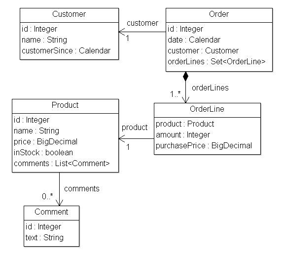
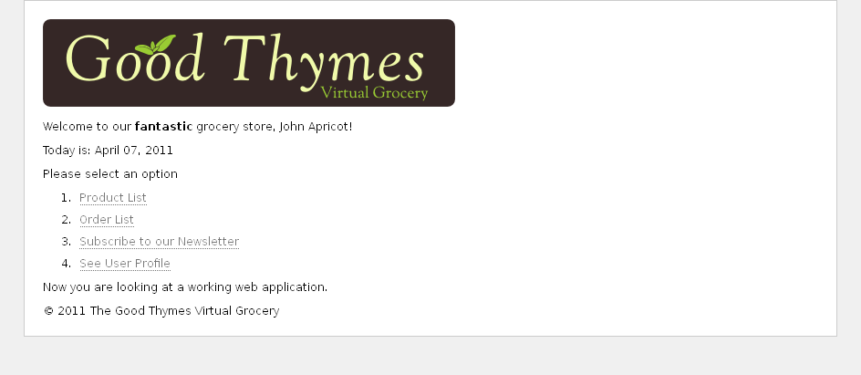

The source code for the examples shown in this, and future chapters of this
guide, can be found in the _Good Thymes Virtual Grocery (GTVG)_ example app
which has two (equivalent) versions:

   * `javax.*` based: [gtvg-javax](https://github.com/thymeleaf/thymeleaf/tree/3.1-master/examples/core/thymeleaf-examples-gtvg-javax).
   * `jakarta.*` based: [gtvg-jakarta](https://github.com/thymeleaf/thymeleaf/tree/3.1-master/examples/core/thymeleaf-examples-gtvg-jakarta).

## A website for a grocery

To better explain the concepts involved in processing templates with Thymeleaf,
this tutorial will use a demo application which you can download from the
project's web site.

This application is the web site of an imaginary virtual grocery, and will
provide us with many scenarios to showcase Thymeleaf's many features.

To start, we need a simple set of model entities for our application: `Products`
which are sold to `Customers` by creating `Orders`. We will also be managing `Comments`
about those `Products`:



Our application will also have a very simple service layer, composed by `Service`
objects containing methods like:

```java
public class ProductService {

    ...

    public List<Product> findAll() {
        return ProductRepository.getInstance().findAll();
    }

    public Product findById(Integer id) {
        return ProductRepository.getInstance().findById(id);
    }
    
}
```

At the web layer our application will have a filter that will delegate
execution to Thymeleaf-enabled commands depending on the request URL:

```java

/*
 * The application object needs to be declared first (implements IWebApplication)
 * In this case, the Jakarta-based version will be used.
 */
public void init(final FilterConfig filterConfig) throws ServletException {
    this.application =
            JakartaServletWebApplication.buildApplication(
                filterConfig.getServletContext());
    // We will see later how the TemplateEngine object is built and configured
    this.templateEngine = buildTemplateEngine(this.application);
}

/*
 * Each request will be processed by creating an exchange object (modeling
 * the request, its response and all the data needed for this process) and
 * then calling the corresponding controller.
 */
private boolean process(HttpServletRequest request, HttpServletResponse response)
        throws ServletException {
    
    try {

        final IWebExchange webExchange = 
            this.application.buildExchange(request, response);
        final IWebRequest webRequest = webExchange.getRequest();

        // This prevents triggering engine executions for resource URLs
        if (request.getRequestURI().startsWith("/css") ||
                request.getRequestURI().startsWith("/images") ||
                request.getRequestURI().startsWith("/favicon")) {
            return false;
        }
        
        /*
         * Query controller/URL mapping and obtain the controller
         * that will process the request. If no controller is available,
         * return false and let other filters/servlets process the request.
         */
        final IGTVGController controller = 
            ControllerMappings.resolveControllerForRequest(webRequest);
        if (controller == null) {
            return false;
        }

        /*
         * Write the response headers
         */
        response.setContentType("text/html;charset=UTF-8");
        response.setHeader("Pragma", "no-cache");
        response.setHeader("Cache-Control", "no-cache");
        response.setDateHeader("Expires", 0);

        /*
         * Obtain the response writer
         */
        final Writer writer = response.getWriter();

        /*
         * Execute the controller and process view template,
         * writing the results to the response writer. 
         */
        controller.process(webExchange, this.templateEngine, writer);
        
        return true;
        
    } catch (Exception e) {
        try {
            response.sendError(HttpServletResponse.SC_INTERNAL_SERVER_ERROR);
        } catch (final IOException ignored) {
            // Just ignore this
        }
        throw new ServletException(e);
    }
    
}
```

This is our `IGTVGController` interface:

```java
public interface IGTVGController {

    public void process(
            final IWebExchange webExchange, 
            final ITemplateEngine templateEngine,
            final Writer writer)
            throws Exception;
    
}
```

All we have to do now is create implementations of the `IGTVGController`
interface, retrieving data from the services and processing templates using the
`ITemplateEngine` object.

In the end, it will look like this:



But first let's see how that template engine is initialized.

## Creating and configuring the Template Engine

The _init(...)_ method in our filter contained this line:

```java
this.templateEngine = buildTemplateEngine(this.application);
```

Let's see now how our `org.thymeleaf.TemplateEngine` object is initialized:

```java
private static ITemplateEngine buildTemplateEngine(final IWebApplication application) {

    // Templates will be resolved as application (ServletContext) resources
    final WebApplicationTemplateResolver templateResolver = 
            new WebApplicationTemplateResolver(application);

    // HTML is the default mode, but we will set it anyway for better understanding of code
    templateResolver.setTemplateMode(TemplateMode.HTML);
    // This will convert "home" to "/WEB-INF/templates/home.html"
    templateResolver.setPrefix("/WEB-INF/templates/");
    templateResolver.setSuffix(".html");
    // Set template cache TTL to 1 hour. If not set, entries would live in cache until expelled by FIFO
    templateResolver.setCacheTTLMs(Long.valueOf(3600000L));

    // Cache is set to true by default. Set to false if you want templates to
    // be automatically updated when modified.
    templateResolver.setCacheable(true);

    final TemplateEngine templateEngine = new TemplateEngine();
    templateEngine.setTemplateResolver(templateResolver);

    return templateEngine;

}
```

There are many ways of configuring a `TemplateEngine` object, but for now these
few lines of code will teach us enough about the steps needed.

### The Template Resolver

Let's start with the Template Resolver:

```java
final WebApplicationTemplateResolver templateResolver = 
        new WebApplicationTemplateResolver(application);
```

Template Resolvers are objects that implement an interface from the Thymeleaf
API called `org.thymeleaf.templateresolver.ITemplateResolver`: 

```java
public interface ITemplateResolver {

    ...
  
    /*
     * Templates are resolved by their name (or content) and also (optionally) their 
     * owner template in case we are trying to resolve a fragment for another template.
     * Will return null if template cannot be handled by this template resolver.
     */
    public TemplateResolution resolveTemplate(
            final IEngineConfiguration configuration,
            final String ownerTemplate, final String template,
            final Map<String, Object> templateResolutionAttributes);
}
```

These objects are in charge of determining how our templates will be accessed
and, in this GTVG application, the use of `org.thymeleaf.templateresolver.WebApplicationTemplateResolver`
means that we are going to retrieve our template files as resources from the
_IWebApplication_ object: a Thymeleaf abstraction that, in Servlet-based applications,
basically wraps around Servlet API's `[javax|jakarta].servlet.ServletContext` object,
and that resolves resources from the web application root.

But that's not all we can say about the template resolver, because we can set
some configuration parameters on it. First, the template mode:

```java
templateResolver.setTemplateMode(TemplateMode.HTML);
```

HTML is the default template mode for `WebApplicationTemplateResolver`, but it
is good practice to establish it anyway so that our code documents clearly what
is going on.

```java
templateResolver.setPrefix("/WEB-INF/templates/");
templateResolver.setSuffix(".html");
```

The _prefix_ and _suffix_ modify the template names that we will be passing to
the engine for obtaining the real resource names to be used.

Using this configuration, the template name _"product/list"_ would correspond to:

```java
servletContext.getResourceAsStream("/WEB-INF/templates/product/list.html")
```

Optionally, the amount of time that a parsed template can live in the cache is
configured at the Template Resolver by means of the _cacheTTLMs_ property:

```java
templateResolver.setCacheTTLMs(3600000L);
```

A template can still be expelled from cache before that TTL is reached if the
max cache size is reached and it is the oldest entry currently cached.

> Cache behaviour and sizes can be defined by the user by implementing the `ICacheManager`
> interface or by modifying the `StandardCacheManager` object to manage the
> default cache.

There is much more to learn about template resolvers, but for now let's have a
look at the creation of our Template Engine object.

### The Template Engine

Template Engine objects are implementations of the `org.thymeleaf.ITemplateEngine`
interface. One of these implementations is offered by the Thymeleaf core:
`org.thymeleaf.TemplateEngine`, and we create an instance of it here:

```java
templateEngine = new TemplateEngine();
templateEngine.setTemplateResolver(templateResolver);
```

Rather simple, isn't it? All we need is to create an instance and set the
Template Resolver to it.

A template resolver is the only *required* parameter a `TemplateEngine` needs,
although there are many others that will be covered later (message resolvers,
cache sizes, etc). For now, this is all we need.

Our Template Engine is now ready and we can start creating our pages using
Thymeleaf.

---

*Adapted from the [Thymeleaf documentation](https://www.thymeleaf.org/doc/tutorials/3.1/usingthymeleaf.html#the-good-thymes-virtual-grocery) at thymeleaf.org, licensed under [CC BY-SA 3.0](https://creativecommons.org/licenses/by-sa/3.0/).*
